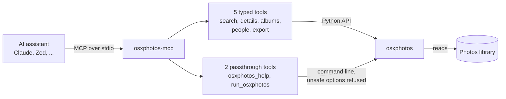

<p align="center">
  
</p>

<p align="center">
  <a href="https://github.com/rscholz98/osxphotos-mcp/actions/workflows/ci.yml"></a>
  <a href="LICENSE"></a>
  
  
  <a href="https://modelcontextprotocol.io"></a>
  <a href="https://github.com/RhetTbull/osxphotos"></a>
</p>

A slim [MCP](https://modelcontextprotocol.io) server that lets an AI assistant search, inspect and export your Apple Photos library. Seven tools, read-only by default.

It is a thin layer over [osxphotos](https://github.com/RhetTbull/osxphotos) by Rhet Turnbull, which does all the real work of reading the Photos library. If this is useful to you, the credit belongs there.

## How it works



## Install

You need macOS and [uv](https://docs.astral.sh/uv/).

**Claude Code**

```sh
claude mcp add photos -- uvx --from git+https://github.com/rscholz98/osxphotos-mcp osxphotos-mcp
```

**Claude Desktop and other MCP clients**

```json
{
  "mcpServers": {
    "photos": {
      "command": "uvx",
      "args": ["--from", "git+https://github.com/rscholz98/osxphotos-mcp", "osxphotos-mcp"]
    }
  }
}
```

Then give the app that runs the server (Claude, your terminal, ...) **Full Disk Access** under System Settings > Privacy & Security. Without it, macOS blocks access to the library.

If the client cannot find `uvx`, use its full path (`which uvx`).

## Tools

| Tool | What it does |
|---|---|
| `search_photos` | Find photos by text, date range, album, person, keyword, place, favorite or media type |
| `get_photo` | Full details of one photo: metadata, albums, labels, camera, location, file paths |
| `list_albums` | Albums, including shared ones, with folder and photo count |
| `list_people_and_keywords` | People and keywords with photo counts |
| `export_photos` | Copy photos to a folder (edited version if there is one, never overwrites) |
| `osxphotos_help` | Look up any osxphotos command and its options |
| `run_osxphotos` | Run any osxphotos command, for everything the tools above don't cover |

The first five are small and typed, so a model gets them right on the first try. The last two reach the rest of osxphotos on demand, without loading hundreds of options into every conversation.

## Options

Add these after `osxphotos-mcp` in the command or `args`:

| Option | Effect |
|---|---|
| `--library PATH` | Use this Photos library instead of the system library |
| `--allow-write` | Enable commands that change your library: `add-locations`, `batch-edit`, `import`, `push-exif`, `sync`, `timewarp` |

## Safety

- Nothing changes your Photos library unless you start the server with `--allow-write`.
- Options that run code (`--post-command`, `--post-function`, `--query-eval` and similar) are always refused, as are the interactive commands.
- `export` writes files wherever the model points it, and the option filter is a best effort, not a sandbox. Give this server to assistants you would trust with the osxphotos command line.

## Development

```sh
git clone https://github.com/rscholz98/osxphotos-mcp && cd osxphotos-mcp
uv sync
uv run pytest
```

Most tests read two of osxphotos' own test libraries and are skipped without them:

```sh
git clone --depth 1 --branch v0.78.1 --filter=blob:none --sparse https://github.com/RhetTbull/osxphotos.git /tmp/osxphotos
git -C /tmp/osxphotos sparse-checkout set tests/Test-13.0.0.photoslibrary tests/Test-Shared-10.15.1.photoslibrary
export OSXPHOTOS_MCP_TEST_LIBRARY=/tmp/osxphotos/tests/Test-13.0.0.photoslibrary
```

## License

MIT. osxphotos is also MIT licensed, © Rhet Turnbull.
